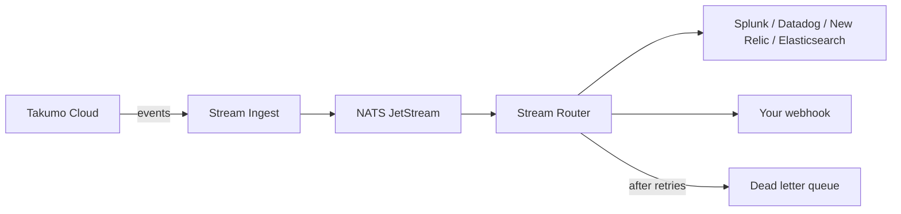

# Takumo Stream

Takumo Stream is the event pipeline. It sends security events from your organization to your SIEM, log platform or webhook: Splunk HEC, Datadog Logs, New Relic Logs, Elasticsearch, or any HTTPS endpoint.

---

## How it works



1. Takumo Cloud records a pull request policy violation, a detected secret or a vulnerability, and sends it to Stream Ingest.
2. Ingest checks the event and writes it to NATS JetStream for durable delivery.
3. Stream Router reads each event and sends it to every destination whose subscriptions match it.
4. A failed delivery is retried with backoff (5 attempts, starting at 1s and doubling, up to 60s). After that it goes to the dead letter queue.
5. Every delivery attempt writes a receipt.

---

## Concepts

### Destinations

Where events are delivered: Splunk HEC, Datadog Logs, New Relic Logs, Elasticsearch, or a webhook. Each destination has a type and encrypted credentials.

Credentials are AES-256-GCM encrypted at rest. The wire format is `nonce(12) || ciphertext+tag(16)` with AAD of `{orgId}:{destinationId}`.

### Subscriptions

Filters that decide which events one destination receives: a minimum severity, categories to include or exclude, and rule ids to include or exclude. An event goes to a destination when any of that destination's enabled subscriptions matches. A destination with no enabled subscription receives nothing.

### Dead letter queue

Failed deliveries are captured in the DLQ. You can:
- View failure reason and payload
- Retry individual events
- Bulk retry
- Delete

### Receipts

Every delivery attempt is tracked:
- Delivery status (success, failed, pending)
- HTTP response code
- Timestamp
- Retry count

---

## Event format

Every event is one JSON object:

| Field | Type | Example |
|-------|------|---------|
| `event_id` | ULID, 26 characters | `01JD3Q8Z5X7K2M9N4P6R8T0V2W` |
| `org_id` | string | your organization id |
| `severity` | `INFO`, `LOW`, `MEDIUM`, `HIGH`, `CRITICAL` | `HIGH` |
| `category` | `SECRET_LEAK`, `VULNERABILITY`, `CODE_QUALITY`, `ARCH_DRIFT`, `POLICY_VIOLATION`, `PATTERN_DEVIATION`, `LICENSE_RISK` | `POLICY_VIOLATION` |
| `rule_id` | string | the rule that fired |
| `title` | string | short summary |
| `description` | string | longer explanation |
| `detected_at` | RFC 3339 timestamp | `2026-11-19T08:00:00Z` |
| `metadata` | object of string values | repository, pull request, file |
| `source_service` | string | `cloud` |
| `source_ref` | string | the id of the record in Takumo |

Detected secrets are sent as metadata about the finding (rule, file, line). The secret value is never in an event.

How each destination type wraps the event:

| Type | Body |
|------|------|
| Splunk HEC | `{"event": <event>, "sourcetype": "takumo:security", "time": <epoch seconds>}` |
| Datadog Logs | `[{"message": <title>, "service": <source_service>, "ddsource": "takumo", "ddtags": "env:<env>,severity:<s>,category:<c>", "status": ..., "host": "takumo-stream-router", "takumo": <event>}]` |
| New Relic Logs | `[{"common": {"attributes": {"service.name": ..., "logtype": "takumo"}}, "logs": [{"timestamp": <epoch ms>, "message": <title>, "attributes": {"takumo": <event>}}]}]` |
| Elasticsearch | `{"index": {"_index": <your index>, "_id": <event_id>}}` then the event, one line each |
| Webhook | the event as the request body |

Datadog tags are lowercase, for example `severity:high,category:policy_violation`.

---

## Verifying streaming webhooks

Every webhook delivery carries three headers:

| Header | Value |
|--------|-------|
| `X-Takumo-Signature-256` | `sha256=` and the hex HMAC-SHA256 of `{timestamp}.{raw body}`, keyed with your signing secret |
| `X-Takumo-Timestamp` | Unix time in milliseconds, the same value that was signed |
| `X-Takumo-Event-Id` | the event's `event_id` |

If you set a token on the destination, Takumo also sends `Authorization: Bearer <token>`.

To verify, compute the HMAC over the timestamp header, a `.`, and the raw body as received. Compare it to the signature in constant time. Reject the request if the timestamp is more than 5 minutes from your clock, so a captured request can't be replayed later.

```typescript TypeScript
import { createHmac, timingSafeEqual } from "crypto";

function verifyStreamWebhook(rawBody: string, headers: Record<string, string>, secret: string): boolean {
  const ts = headers["x-takumo-timestamp"];
  const sig = headers["x-takumo-signature-256"] ?? "";
  if (!ts || Math.abs(Date.now() - Number(ts)) > 5 * 60 * 1000) return false;
  const expected = "sha256=" + createHmac("sha256", secret).update(`${ts}.${rawBody}`, "utf8").digest("hex");
  return sig.length === expected.length && timingSafeEqual(Buffer.from(sig), Buffer.from(expected));
}
```

<Note>Streaming webhooks sign `{timestamp}.{body}` in `X-Takumo-Signature-256`. Product webhooks (members, billing and similar) use a different header and scheme. See [Webhooks](/api/webhooks).</Note>

---

## Permissions

| Permission | What it grants |
|------------|---------------|
| `streaming.read` | View destinations, subscriptions, DLQ, receipts |
| `streaming.write` | Create/edit destinations and subscriptions |
| `streaming.admin` | Full control including deletion |

<Note>Billing Admins have no streaming permissions. The streaming section is hidden from the sidebar and command palette for users without `streaming.read`.</Note>

---

<CardGroup cols={2}>
  <Card title="Dashboard Streaming" icon="radio" href="/dashboard/streaming">
    Manage streaming in the dashboard
  </Card>
  <Card title="Deploy Stream" icon="cloud" href="/deployment/streaming">
    On-prem Stream pipeline deployment
  </Card>
</CardGroup>
